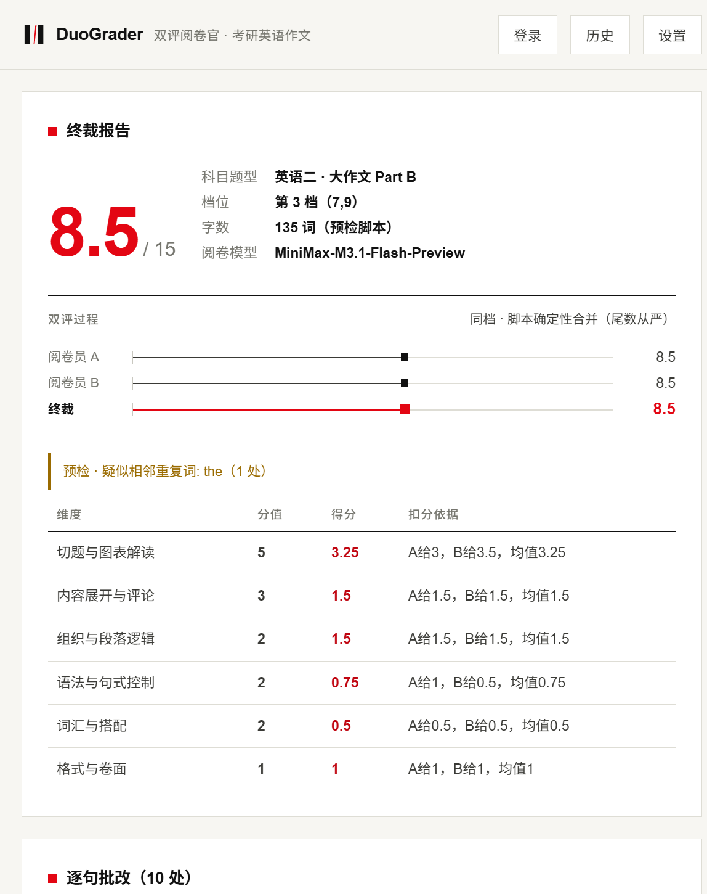

<div align="center">


# DuoGrader · 双评阅卷官

**像真实考研阅卷一样批改你的英语作文**

两位 AI 阅卷员独立盲评 · 分差仲裁 · 逐句精改 · 确定性预检
自带 API Key 免会员；也可用邀请码走内置算力

[](https://github.com/5777-wq/duograder/actions/workflows/ci.yml)
[](LICENSE)
[](https://duograder.pages.dev/app/)

**🌐 [在线使用 · 无需安装](https://duograder.pages.dev/app/)**　|　📦 [安卓 App](https://github.com/5777-wq/duograder/releases/latest/download/DuoGrader.apk)　|　🤖 [Agent Skill](#-agent-skill)



*一次真实批改的终裁报告：双评过程、维度拆解、三级逐句批改、可执行训练建议*

</div>

---

## 目录

[为什么是「双评」](#为什么是双评) · [五种用法](#五种用法) · [API 设置怎么填](#api-设置怎么填新手向) · [Agent Skill](#-agent-skill) · [工作原理](#工作原理) · [成绩曲线](#成绩曲线看得见的进步) · [核心资产](#核心资产) · [架构与工程约定](#架构与工程约定) · [验证](#验证) · [开发与部署](#开发与部署) · [共享算力](#共享算力可选自托管) · [隐私](#隐私) · [已知局限](#已知局限) · [接下来可以做的](#接下来可以做的)

---

## 为什么是「双评」

单次 LLM 打分的顽疾：**同一篇作文，评两次能差出一个档位**——分数飘、把对的改错、字数靠猜。DuoGrader 的判断是：瓶颈不在模型，在评分流程。所以我们把真实考研阅卷的制度搬了过来：

| 单次提问的老毛病 | DuoGrader 的对策 |
|---|---|
| 分数会飘，评两次差一档 | **双盲双评**：两位阅卷员独立请求、互不可见；同档取均值，差档仲裁员依档位描述强制二选一 |
| 把对的改错、过度润色 | **三级错误分级**：error 扣分 / awkward 提示 / style 仅润色；拿不准一律降级，宁漏勿冤 |
| 字数数不对、格式看不见 | **确定性预检**：字数、段落、格式由脚本计算，评分者只准引用、禁止自算 |
| 报告自相矛盾无人发现 | **机器校验**：维度分之和必须落在档位区间内，不达标自动打回重评 |

效果有数：同一篇作文 3 轮双评**档位零波动**；12 颗预植错误的句级查全率 **100%**、误报 **0**；35 处逐句批改人工审计**把对的改错 = 0**。全部实验记录公开在 [`docs/validation/`](docs/validation/)，失败照报。

---

## 五种用法

**🌐 网页 / 手机（推荐，零安装）**
打开 [duograder.pages.dev/app](https://duograder.pages.dev/app/) → 设置里选供应商、贴上 API Key → 点「试一下」，四项全绿就自动保存 → 拍照或拖入作文 → 核对 AI 转写 → 双评。

**📱 PWA（手机上像原生 App）**
在手机浏览器打开上面的链接 →「添加到主屏幕」。独立图标、独立窗口、无地址栏，**断网也能打开**（应用壳与历史记录本地可看，批改当然要联网）。已带 service worker，离线降级有明确提示。

**📦 安卓 App**
直接下载 [最新版 APK](https://github.com/5777-wq/duograder/releases/latest/download/DuoGrader.apk)（安装需允许未知来源）。原生壳为 Capacitor，源码在本仓 `android/`；推送 `app/` 或 `android/` 变更后 CI（apk.yml）自动构建。无跨域限制，任意供应商可直连。

**🖥️ 桌面壳（Electron）**
```bash
cd app && npm ci && npm start
```
自用本地应用：内置静态服务器 + 放开渲染进程跨域限制，**任意供应商 API 都能直连**（不用再装浏览器 CORS 插件）。本地服务器只暴露页面与 `skill/`，仓库里的 `.git/`、`data/`（你的批改记录）都在射程之外。

想打包成免安装 exe：`cd app && npm run dist`（需先跑一次 `python scripts/sync_app.py` 生成 `app/skill/` 构建副本）。推 `v*` 标签时 CI（desktop.yml）会自动出便携版并挂到 Release。

**🤖 [Agent Skill](#-agent-skill)**

> **草稿兜底**：一次批改要跑 2-3 分钟。手机锁屏、切后台、浏览器回收标签页都可能让页面重载，作文在 DOM 里，重载即消失——所以输入的作文与题面会**自动存一份本地草稿**，下次打开自动恢复；批改成功后草稿自动清除。

---

## API 设置怎么填（新手向）

设置弹窗的主流程只有三步，模型名和地址这些容易劝退人的字段都收进了「高级设置」：

| 步骤 | 做什么 | 说明 |
|---|---|---|
| **先选路径** | 不想折腾 / 我有 API Key / 我要完全本地 | 「不想折腾」直接走内置算力（每 IP 免费 50 次），「完全本地」自动切到 Ollama |
| **① 选供应商** | 每个选项都写清了「适合谁」和直连状态 | 🟢 可直连 / 🔴 需反代 / ⚪ 仅本地，一眼知道哪家能用 |
| **② 贴上 API Key** | 贴上去自动填好地址与模型 | Key 前缀能认出来的（OpenRouter / Anthropic / Gemini / 智谱 / 火山）会自动切供应商；认不出来的**不乱猜** |

然后点**「试一下」**：直连 → 模型列表 → 主模型对话 → 视觉模型真图测试，四项全绿才自动保存。

**每项失败都给出「怎么办」，而不是甩一个错误码。** 新手最常撞的坑都写在里面了：

- **浏览器直连被拦**（本 app 的头号坑）——这家供应商不允许网页跨域调用。办法：改用桌面壳（`cd app && npm start`），或让对方给你一个反代地址填进高级设置的 Base URL。
- **401 / 403** —— Key 不对、没复制全、或者账户没充值（不少平台不充值直接 401）。
- **主模型不通** —— 多半是模型名不对，点「拉取模型列表」从下拉里挑一个账号真正可用的。
- **视觉模型失败** —— 这个型号不认图，换 `glm-4v-flash` / `qwen-vl-plus` / `gpt-4o-mini` 这类多模态型号。拍照转写必须有一个认图的模型，主模型通常不认图。

> 不知道选哪家？**DeepSeek** 最便宜且国内直连，适合第一次用；**OpenRouter** 一把 Key 调几十家模型（有免费模型可白嫖）；**Ollama / LM Studio** 完全本地、作文不出电脑；**火山方舟 / Anthropic** 质量好但浏览器直连被拦，得配桌面壳。

---

## 🤖 Agent Skill

适用于 Codex / Claude Code / ZCode 等支持 skill 的 agent：

```bash
git clone https://github.com/5777-wq/duograder.git
```

把仓库交给你的 agent，说："读取 `skill/kaoyan-essay/SKILL.md` 并按其执行：批改这篇考研英语作文"。宿主将自动完成预检、双盲评分、机器校验与仲裁。

内核本身是**宿主无关**的：`SKILL.md`（带标准 frontmatter）+ 评分规则 + 输出契约 + 版本化提示词 + 确定性脚本，五件套齐备，不绑定任何具体 provider。

> ⚠️ **一个诚实的限制**：双盲的全部价值在于两位阅卷员互不可见。SKILL.md 第 4 步靠"并行派出两个独立 subagent"实现这一点——需要宿主支持 subagent。宿主不支持时按 SKILL.md 的降级条款由单上下文做两轮自评，**独立性弱于标准流程**，报告会明确标注。把"双盲执行"下沉到宿主之外（例如做成 MCP 工具，由服务端发两次互不可见的请求）是彻底解法，属下一步工作。

> 💰 **成本**：一次完整批改 = 3 次模型调用（双评 + 可能的仲裁）。按 DeepSeek / GLM 计价约一两分钱，一个备考季花不了一顿早饭。

---

## 工作原理

```
题面 + 作文 + 预检事实
        │
   ┌────┴────┐
   ▼         ▼          两次独立请求，互相看不到对方
 阅卷员 A   阅卷员 B     （同一 Key 同一模型即可，无需两个账号）
   └────┬────┘
        ▼
   同档 → 脚本均值合并（确定性算术）
   差一档 → 仲裁员引用档位描述强制二选一
   差两档 → 判定失效，自动重评
        ▼
   终裁报告：维度表 / 逐句批改 / 修改版 / 训练建议
```

报告头部的**双评汇聚尺**把这个过程画出来：两位阅卷员的初评与终裁分落在同一条 0..满分 刻度上——同档时两个刻点垂直对齐（均值合并），差一档时刻点分离、终裁精确落在被采信的一方。不用读说明文字，一眼就知道这一分是怎么来的。

**同档合并由脚本执行，档位之争才交给仲裁员**——这条边界必须严守：仲裁协议是"差一档二选一"，若把"同档但维度口径对不齐"也丢给仲裁员，等于整份挑一份，把确定性均值合并的稳定性丢掉了。分流规则写在 `scripts/average_reports.py` 的退出码里：

| 退出码 | 含义 | 下一步 |
|---|---|---|
| 0 | 合并成功 | 直接渲染终裁报告 |
| 2 | 档位不一致 / 合并后越界 | 派仲裁员 |
| 3 | 两位阅卷员维度集合对不齐 | 打回重评，**不仲裁** |

网页端走的是同一套规则（`app/core.js` 的 `mergeSameBand`），两条路径的结论由 CI 断言强制一致。

---

## 成绩曲线：看得见的进步

打开右上角「历史」抽屉，第一屏就是成绩曲线：

- **纵轴是得分率（得分 ÷ 该题型满分）**——英一大作文 20 分、英二大作文 15 分、小作文 10 分，原始分没法画在一条线上，折算成百分比才看得出是涨还是跌。
- 统计条给出批改篇数、平均得分率、最高、最低；**不足 4 篇不给趋势结论**（样本太少，说了也是误导）。
- 虚线是平均得分率；方块点可以点进去看那次的报告；最后一个点用瑞士红标出，是最近一次。
- 下面是按科目题型的分项小计（篇数 + 平均得分率）。

**历史记录只存在本机浏览器**（IndexedDB），不上传、不出本机。删除也是你的权利：

- **单条删除**：点「删除」会变成「确认删除」，4 秒内再点一次才真删——误删一篇批改好的作文赔不起。
- **清空全部**：抽屉底部有「清空全部历史」，同样两步确认。

## 核心资产

### 内核（评分这件事本身）

| 位置 | 是什么 |
|---|---|
| [`skill/kaoyan-essay/SKILL.md`](skill/kaoyan-essay/SKILL.md) | 阅卷流程编排：识别 → 转写确认 → 预检 → 双盲 → 合并/仲裁 → 渲染 |
| [`skill/kaoyan-essay/rubrics/writing-rubric.md`](skill/kaoyan-essay/rubrics/writing-rubric.md) | 官方五档评分规则转写（档位描述是仲裁时的引用依据） |
| [`skill/kaoyan-essay/schema/grading-report.schema.json`](skill/kaoyan-essay/schema/grading-report.schema.json) | 机器可校验的输出契约 |
| [`skill/kaoyan-essay/prompts/`](skill/kaoyan-essay/prompts/) | 版本化提示词（阅卷员 / 仲裁员） |
| [`skill/kaoyan-essay/references/past-prompts-index.md`](skill/kaoyan-essay/references/past-prompts-index.md) | 历年真题索引（用于题面比对定科目） |
| [`skill/kaoyan-essay/scripts/`](skill/kaoyan-essay/scripts/) | 确定性脚本：预检 / 报告校验 / 同档合并 / 种子评估 |
| [`skill/kaoyan-essay/tests/fixtures/`](skill/kaoyan-essay/tests/fixtures/) | 测试用作文与题面样本 |

改任何一处 → 跑 [种子错误评估](skill/kaoyan-essay/scripts/eval_planted.py) → 查全率/误报量化对比——内核迭代有数可依。

### 应用层

| 位置 | 是什么 |
|---|---|
| [`app/core.js`](app/core.js) | 同一套内核的浏览器实现（纯函数，ESM，Node 也能加载）+ 成绩曲线计算与 SVG 绘制 |
| [`app/ui.js`](app/ui.js) | 编排层：预检 → 双盲 → 校验 → 合并/仲裁 → 渲染 → 历史归档 |
| [`app/style.css`](app/style.css) | 瑞士国际主义视觉系统（网格 / 无衬线 / 单强调色 / 圆角 0） |
| [`app/sw.js`](app/sw.js) | Service Worker：网络优先 + 离线回落，把网页变成可安装的 App 壳 |
| [`app/electron-main.cjs`](app/electron-main.cjs) + [`app/static-server.cjs`](app/static-server.cjs) | 桌面壳：内置静态服务器（白名单 + 路径分量守卫） |
| [`app/test.mjs`](app/test.mjs) / [`app/parity.mjs`](app/parity.mjs) / [`app/static-server.test.mjs`](app/static-server.test.mjs) | 应用层回归与跨实现一致性断言 |

### 共享算力层

| 位置 | 是什么 |
|---|---|
| [`proxy/proxy-core.js`](proxy/proxy-core.js) | 代理内核真源：两套部署入口共用（配额 / 白名单 / CORS / 限速） |
| [`functions/v1/`](functions/v1/) | Pages Functions 入口（主路径，与网页同域，国内可直连） |
| [`workers/invite-proxy/`](workers/invite-proxy/) | Cloudflare Worker 入口（备用路径，海外 / 自托管） |
| [`scripts/sync_app.py`](scripts/sync_app.py) | 单一真源同步：app/ → 三份副本、proxy/ → 两份副本，兼漂移检查 |

---

## 架构与工程约定

这一节写的是"改动时必须遵守的规矩"，也是这个仓库最容易被人改坏的地方。

**① 单一真源，副本由脚本生成**
`app/` 是前端的唯一真源，`proxy/proxy-core.js` 是代理的唯一真源。所有副本（`.pages-dist/`、`www/`、APK 资产、`functions/v1/_proxy-core.js`、`workers/invite-proxy/_proxy-core.js`、`app/skill/`）都由 `scripts/sync_app.py` 生成，**不要手工改副本**。CI 用 `python scripts/sync_app.py --check` 断言无漂移。

**② 同一套内核，两种实现，必须同口径**
`app/core.js`（JS）与 `skill/kaoyan-essay/scripts/`（Python）是同一套规则的两份实现。`app/parity.mjs` 会在 CI 里断言：预检事实清单逐字段一致、报告校验的失败项数一致、同档合并的终裁分与退出语义一致。历史上它们悄悄漂移过三处，导致同一份报告在网页端通过、在 Skill 端被打回——**现在这类漂移会直接让 CI 变红**。

**③ 退出码就是协议**
`average_reports.py` 的退出码（0 合并 / 2 仲裁 / 3 打回重评）是 Web 端与 Skill 端共用的分流规则。改它要同时改 `app/core.js` 的 `mergeSameBand` 与 `app/ui.js` 的分流分支。

**④ 动画安全铁律**
"出现型"关键帧（`rise` / `numberIn` / `popIn` / `bannerIn` / `thumbIn` / `drMark`）**只动 transform，绝不从 `opacity: 0` 起步**；入场动画统一挂 `.anim-ok` 开关（JS 双 rAF 后才启用）。原因：窗口被遮挡或标签页在后台时动画时间线会冻结，带 `fill-mode: both` 的入场动画会把内容永远卡在透明——**白屏比没有淡入严重得多**。现在时钟冻结时内容最多差 6px，永远可见。

**⑤ 路径安全按分量判断**
桌面壳的静态服务器只暴露白名单子树，守卫用 `path.relative` 按路径分量判断（不用 `startsWith` 字符串前缀——那会被同前缀兄弟目录绕过），并校验 Host 头防 DNS rebinding。`app/static-server.test.mjs` 覆盖了这些。

**⑥ 共享算力的安全默认值**
上游地址写死、客户端无法指定目标；不转发客户端原始头，逐个重建；模型白名单 + `max_tokens` 封顶（限制单次成本）；配额先扣后调、上游失败退额；CORS 白名单只放行本应用来源。

**⑦ 失败必须让用户看见**
初始化失败会直接在页头横幅报出来，不留一个"所有按钮都没反应"的死页面；诊断的每一项失败都带"怎么办"。

---

## 验证

### 评分质量（预注册，失败照报）

| # | 实验 | 标准 | 结果 |
|---|---|---|---|
| 1 | 同篇双评跑 3 遍 | 档位波动 0 档 | ✅ 8.5 / 8.5 / 8.5，零波动 |
| 2 | 逐句批改抽查 ≥20 处 | 把对的改错 = 0 | ✅ 35 处全量核对，0 处（[报告](docs/validation/audit-20261009.md)） |
| 3 | 字数统计 vs 人工 | 误差 ≤ 2 词 | ✅ 确定性实现，误差 0 词 |
| 4 | 分档区分度 | 好/中/差分数递减 | ✅ 14 / 8.5 / 7 |
| 5 | 句级种子查全率 | 预植错误检出 | ✅ 内核 v1.0 92% → v1.3 **100%**，误报 0（[记录](docs/validation/kernel-eval-20261009/SUMMARY.md)） |
| 6 | 跨档位覆盖 | 英一 20 分档 / 小作文 10 分档 | ✅ 分值表、档位区间、格式检测均正确（[报告](docs/validation/coverage-20261009/SUMMARY.md)） |

### 工程回归（CI 每次 push 跑，173 项断言）

| 套件 | 断言 | 守住什么 |
|---|---|---|
| `node app/test.mjs` | 100 | 字数口径、预检、JSON 容错解析、报告校验、同档合并、题型识别、反模板黑名单、汇聚尺刻度、Key 前缀识别、草稿恢复判定、成绩曲线统计与 SVG |
| `node proxy/proxy-core.test.mjs` | 28 | CORS 放行与 expose、配额先扣后调与退额、模型白名单、max_tokens 封顶、IPv6 归并、限速表不无界增长 |
| `node app/parity.mjs` | 18 | **JS 与 Python 必须同口径**：预检事实清单逐字段一致、校验失败项数一致、合并终裁分与退出语义一致 |
| `node app/static-server.test.mjs` | 27 | 桌面壳本地端口不暴露 `.git/` 与 `data/`、路径穿越（含同前缀兄弟目录与 URL 编码）被拒、非法百分号编码不崩、Host 校验防 DNS rebinding、开发态/打包态白名单各放该放的 |
| `python scripts/sync_app.py --check` | 1 项检查 | 副本与真源无漂移（代理内核 + 桌面壳的 `app/skill/`） |

> 「同口径」不是口号，是 CI 里可执行的断言。

---

## 开发与部署

### 本地开发

```bash
# 从仓库根起服务（评分规则用 ../skill/… 相对路径加载，必须从根起）
python -m http.server 8731
# 打开 http://127.0.0.1:8731/app/
```

桌面壳开发模式：`cd app && npm ci && npm start`。

### 常用命令

```bash
python scripts/sync_app.py            # 同步所有副本（改完 app/ 或 proxy/ 后跑）
python scripts/sync_app.py --check    # 只校验有无漂移（CI 用这个）
node app/test.mjs                     # 应用层回归
node proxy/proxy-core.test.mjs         # 代理内核回归
node app/parity.mjs                   # JS / Python 跨实现一致性
node app/static-server.test.mjs       # 桌面壳静态服务器回归
cd skill/kaoyan-essay && python scripts/precheck.py --track english-ii --task large <作文.txt>
```

### 三条 CI 流水线

| 流水线 | 触发 | 产出 |
|---|---|---|
| `ci.yml` | 每次 push / PR | 150 项断言 + 副本漂移检查 + 评分脚本冒烟 |
| `apk.yml` | `app/` `android/` `skill/` 变更 | 安卓 APK（artifact） |
| `desktop.yml` | push 到 main / 打 `v*` 标签 | Windows 便携版 exe；标签推送时挂到 Release |

### 部署到 Pages

```bash
python scripts/sync_app.py                                   # 生成 .pages-dist（只含 app/+skill/+跳转页）+ 同步代理副本
wrangler pages secret put MINIMAX_API_KEY
wrangler pages secret put INVITE_CODE
wrangler pages deploy
```

> **为什么输出目录是 `.pages-dist` 而不是仓库根**：仓库根里还有 `data/`（你的批改记录）、`node_modules/`、`android/`。整根发布会把它们一并暴露到公网，所以 `wrangler.toml` 的 `pages_build_output_dir` 指向 `.pages-dist`。

---

## 共享算力（可选，自托管）

想给同学/学生免配置直接用？附赠一个代理，两套等价部署：

- `functions/v1/` —— **Cloudflare Pages Functions**（主路径，与网页同域 `duograder.pages.dev/v1`，国内可直连）
- `workers/invite-proxy/` —— **Cloudflare Worker**（备用路径，海外 / 自托管参考）

两者共用同一份实现 `proxy/proxy-core.js`（真源），副本由 `scripts/sync_app.py` 同步，CI 断言二者与真源逐字节一致——历史上这两套曾经漂移过一次（Worker 缺匿名通道、免费额度与配额查询，Pages 缺 IPv6 归并）。

### 两种访问方式

| 方式 | 怎么用 | 额度 |
|---|---|---|
| **邀请码** | 点右上角「登录」输入邀请码 | 不限次 |
| **匿名免费** | 什么都不填，直接用 | 每 IP + 设备指纹共 50 次（180 天） |

匿名免费额度需要 KV 计数绑定（`FREE_KV`）。本仓的 `wrangler.toml` 里已绑好；自建部署时 `wrangler kv namespace create FREE_KV` 后把返回的 id 填进 `[[kv_namespaces]]`。**没绑时只有邀请码模式可用。**

### 安全设计

- **API Key 只存服务端加密 secret**，前端和仓库里永远只有一个邀请码占位
- **上游地址写死**，客户端无法指定目标；**不转发客户端原始头**，逐个重建
- **模型白名单**：客户端不能借你的 key 调用任意模型
- **max_tokens 封顶**（匿名 12k / 邀请码 32k）：限制单次成本，防止免费额度被拿去跑无上限生成
- **配额先扣后调，上游失败退额**：并发请求不会同时越过配额检查
- **每 IP 限速** 120 次 / 10 分钟（实例内存滑动窗口，是第一道闸不是精确计量）；IPv6 按 /64 前缀归并
- **CORS 白名单**只放行本应用来源（`ALLOWED_ORIGINS` 可配，支持 `*.example.com` 通配，按域分量匹配）
- **不落作文数据**：代理纯转发，只有计数进 KV

代码里的代理地址是演示实例；自己部署后，在 `app/core.js` 的 `PRESETS` 里改一行 `baseURL` 即可。

---

## 隐私

**分两种情况，说清楚：**

**① 你自带 API Key（默认）**
Key 与全部批改数据只存在**你的浏览器/手机本地**（localStorage / IndexedDB）。请求**直发你自己配置的供应商**，不经过任何 DuoGrader 服务器。仓库与线上实例都不参与。

**② 邀请码 / 匿名免费额度（走共享算力）**
请求会经过 `duograder.pages.dev` 的 Pages Function（或自建的 Worker）再转发给模型供应商——**作文内容会经过这个代理**。代理**不存储作文内容**（纯转发），但会写三类计数到 KV：每 IP 的免费次数、每设备指纹的免费次数、全站当天的匿名总次数。限速窗口是实例内存里的滑动窗口，不落盘。

设备指纹只在内置算力通道生成并发送（存 localStorage，清浏览器数据才会变）；**你自带 Key 直连第三方时不会发送**。

> 仓库与线上实例**有**后端（就是上面这个转发代理）。它只做转发与计数，不落作文、不做统计上报、不回传任何数据。

---

## 已知局限

如实说，不藏着：

- **"稳"已证明，"准"欠校准**——没有人工专家分对照前，绝对档位会随内核版本小幅漂移（v1.0→v1.3 同篇漂移一档，均在可辩护范围）。人工锚点校准（锚点样文 / pairwise 排序）是内核下一个研究方向。
- 全部质量验证基于合成作文；真实手写字迹的转写质量、真实考生的错误分布待真实样本补充。
- **纯前端直连供应商 API**：绝大多数主流供应商可用（实测 10 家中 8 家可直连），个别拦截的需要桌面壳或反代。
- **小作文的科目（英一/英二）无法从题面自动判定**——两者都是"约 100 词 / 10 分"，题面没有科目硬信号。网页端会明确提示你手动确认（判错科目会连分值制一起错）；SKILL.md 侧则靠真题年份匹配。
- **匿名免费额度的计数基于 KV**，KV 是最终一致的，跨 isolate 的并发理论上存在竞争窗口——已用 isolate 内串行化 + 全站每日 300 次上限双重兜底，但不是强一致计数。
- **JS 与 Python 是同一套内核的两份实现**。已用 CI 断言同口径，但改一边忘了另一边仍可能发生（CI 会红，别忽略）。
- Agent Skill 在不支持 subagent 的宿主上会退化为单上下文双评，独立性弱于标准流程。
- **PWA 离线只覆盖应用壳**：离线能打开界面、看本地历史，但评分规则（`/skill/…`）不在 service worker 的作用域内，批改必须联网。
- **草稿只存文本**：转写出来的照片是 base64，塞不进 localStorage，所以页面被重载后要重新拍照——但已转写出的文字会恢复。

---

## 接下来可以做的

按「对考研学生的实际价值」排序，不含插件适配：

1. **报告导出与分享**——把终裁报告导出成 Markdown / 图片，方便存档、发给研友互批。现在历史抽屉里只能看。
2. **安卓壳的版本提示**——APK 要手动从 Release 下载，网页版却是即时的。APK 用户不知道有没有新版，加个「检测到新版本」的提示能省掉一半重复反馈。
3. **批量批改**——一次传多篇（比如整个考研班的作文）排队跑，复用同一套双评内核，边际成本几乎为零。
4. **阶段结果持久化**——现在草稿只存输入。双评跑到一半网络断了，A 的报告得重跑；把每阶段的报告也落盘，断点续跑能省一次钱。
5. **人工锚点校准**——把 rubric 的绝对档位对上人工专家分（锚点样文 / pairwise 排序），解决"准欠校准"这条。

---

## 致谢

评分规则的组织思路参考了 [echo-kaoyan-english-skill](https://github.com/nghjjnjnf/echo-kaoyan-english-skill)；官方档位描述转写自考研英语大纲评分标准。

## License

MIT
